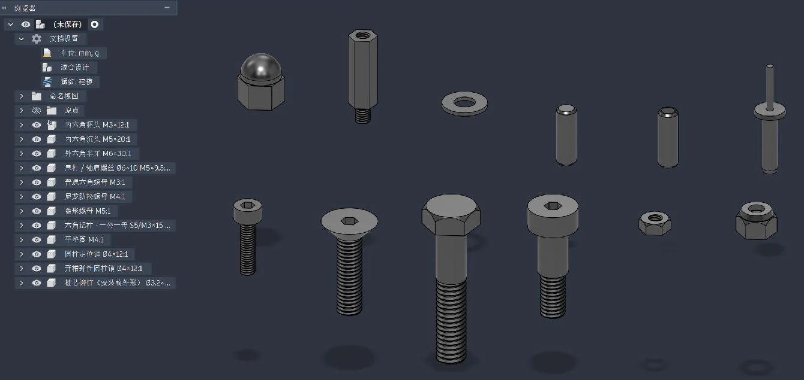
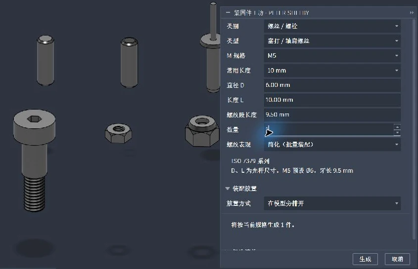
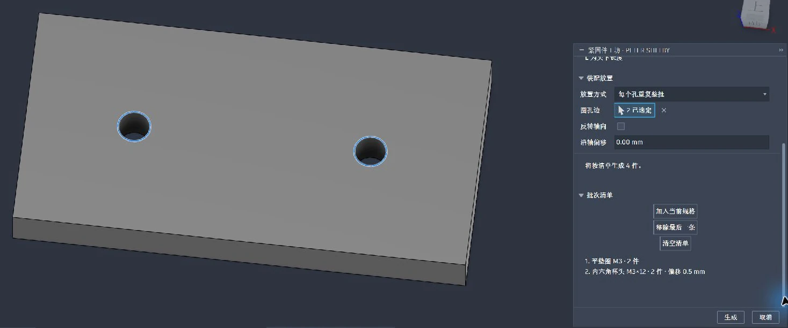
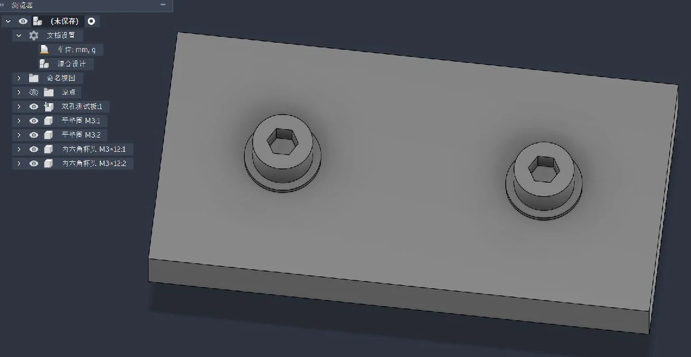

# Fusion 紧固件工坊 · Peter Shelby

**为 Autodesk Fusion 桌面版批量生成公制紧固件，并沿已有圆孔的轴线放置。** 适合机器人底盘和支架、板件连接、传感器隔柱，以及包含重复孔位的机械装配。

设计板件时，经常要先确认螺丝头和螺母是否碰到相邻零件、垫圈有没有足够的支承面，以及隔柱能否给电路板或传感器留出空间。紧固件工坊把常用规格、数量和放置方式放在同一个面板里。生成结果是 Fusion 实体组件，可继续移动、添加关节和检查干涉。同一批次中，相同规格共享一个组件定义，每件各有一个装配实例。

[下载 v0.1.1 安装 ZIP](https://github.com/petershe1by/fusion-fastener-workbench/raw/refs/tags/v0.1.1/dist/FusionFastenerWorkbench-v0.1.1.zip) · [查看发布说明](https://github.com/petershe1by/fusion-fastener-workbench/releases/tag/v0.1.1)

*Windows 版 Fusion 实机截图。同批生成的 12 件样品分两排展示，其中带牙零件使用了 Fusion 实体螺纹。*

## 安装

1. 下载 **安装 ZIP**，解压到准备长期保留的位置。里面的 `FusionFastenerWorkbench` 文件夹包含入口脚本、`.manifest`、建模模块和图标资源，请将它们一起保留。
2. 在 Fusion 按 `Shift+S` 打开 **脚本和附加模块**，切换到 **附加模块**。点 **+ → 从设备添加**，选择直接包含 `FusionFastenerWorkbench.manifest` 的文件夹，再选中该附加模块并运行。
3. 打开或新建一个 **混合设计**。从 **设计 → 实体 → 创建 → 紧固件工坊 · Peter Shelby** 打开面板。创建菜单项旁有六角形 **PS** 图标。
4. 第一次使用时，可以先在空设计生成两件 **M3 × 12 内六角杯头**。在默认的 **在模型旁排开** 模式下，生成后应看到两个组件实例，不需要先画孔。

插件由 Fusion 内置的 Python 环境运行，无需另装 Python 包。仓库声明支持 Windows 和 macOS，本文的实机验证在 **Windows 版 Fusion** 完成。若 Fusion 提示使用混合设计，可在 **文档设置** 中查看当前设计类型，或先用一个新的混合设计验证安装。

从 v0.1.0 升级时，先在附加模块管理器停止旧版。用新版本的整套文件替换 Fusion 当前读取的插件目录，再重启 Fusion。若电脑上保留了多个解压副本，可在管理器核对路径，避免继续运行旧副本。

## 规格和尺寸

当前收录 **30 种类型**。选定类型后，面板只显示该类型需要的尺寸。带标准号的条目以对应标准或产品目录的常用尺寸为参考，具体可选规格以面板下拉菜单为准。

| 类别 | 类型 | 参考系列或输入 |
| --- | --- | --- |
| 内六角螺丝 | 杯头、薄杯头、圆头、沉头 | ISO 4762、DIN 7984、ISO 7380-1、ISO 10642 |
| 十字螺丝 | 十字盘头、十字沉头 | ISO 7045 参考外形、90° 沉头参考外形 |
| 外六角螺栓 | 全牙、半牙 | ISO 4017、ISO 4014 |
| 内六角紧定 | 平端、凹端 | ISO 4026、ISO 4029 参考外形 |
| 塞打 / 轴肩螺丝 | 内六角轴肩螺丝 | ISO 7379 系列，M 规格、光杆直径、光杆长度、螺纹段长度 |
| 螺母 | 普通六角、尼龙防松、薄六角、无齿法兰、盖形 | ISO 4032、DIN 985、ISO 4035、ISO 4161、DIN 1587 |
| 铝柱 / 隔套 | 圆柱通孔、六角通孔、圆柱内牙、六角内牙、六角一公一母 | 自定义外径或对边、柱长、通孔直径或内螺纹，公母柱可设公牙长度 |
| 销 | 圆柱定位、开槽弹性、圆锥、带头带横孔 | 自定义直径与长度，分别参考 ISO 8734、8752、2339、2341 外形 |
| 垫圈 | 平垫圈、加大平垫圈、开口弹垫 | ISO 7089、ISO 7093-1、DIN 127 B 压平外形 |
| 牙条 / 铆钉 | 全牙螺杆、抽芯铆钉 | DIN 976-1 参考外形、自定义铆体直径和头下长度 |

### 长度和直径怎么填

- **杯头、圆头、外六角等带头螺丝**的 `长度 L` 从头下量到尾端。**沉头**的 `长度 L` 是含头总长。常用长度可以直接选，也可以手填。外六角半牙随公称直径和长度计算螺纹段，较短的组合可能得到全牙。
- **塞打**先选螺纹 M 规格，再查看预填的光杆直径和螺纹段长度。例如 M5 预填光杆 Ø6、螺纹段 9.5 mm。界面中的 `长度 L` 只表示光杆长度。修改 M 规格会重新填入光杆直径和螺纹段长度，保留现有的 `长度 L`。光杆直径、光杆长度和螺纹段长度都可以手动调整。[Elesa+Ganter 规格表](https://www.elesa.com/siteassets/PDF/PDF_US/ISO%207379.pdf)
- **铝柱**的外尺寸按截面分别填写圆柱外径或六角对边 `S`。通孔款输入内孔直径，内牙款选 M 规格。一公一母款的 `长度 L` 指柱体长度，`螺纹段长度` 指伸出的公牙。
- **圆锥销**的 `直径 D` 指小端直径，模型锥度为 1:50。**带头销轴**填写头下长度。垫圈按配套螺丝选 M 规格，面板会显示内径、外径和厚度。

### 螺纹表现怎么选

| 模式 | 模型结果 | 适用场景 |
| --- | --- | --- |
| **简化（批量装配）** | 螺纹段以圆柱表示，螺纹规格写入组件属性 | 底盘、支架等大量紧固件的布置和空间检查 |
| **Fusion 外观螺纹** | 生成 Fusion 原生螺纹特征，以外观表示牙纹 | 希望在 Fusion 中看到螺纹特征，同时保持装配轻量 |
| **Fusion 实体螺纹** | 原生特征生成实际牙纹几何 | 对少量零件放大查看牙纹或展示模型细节 |

当前使用公制粗牙右旋，原生外螺纹为 6g、内螺纹为 6H。螺纹表现应用于本次生成的整批零件。实体螺纹的计算量更高，规模较大的装配可先用简化模式确定位置。[Autodesk ThreadInfo](https://help.autodesk.com/cloudhelp/ENU/Fusion-360-API/files/fusion_ThreadInfo_create.htm)

## 批量生成和按孔装配

**一条规格可设 1–200 件，每次生成合计最多 500 件。** 只做一种规格时，填好尺寸和数量后直接点 **生成**。要在一次操作里混合螺丝、销或垫圈，展开 **批次清单**，每设好一条规格就点 **加入当前规格**。清单有内容时，**生成**按清单执行。要改动已加入的最后一条，可以移除后重新加入。

| 放置方式 | 数量规则 | 什么时候用 |
| --- | --- | --- |
| **在模型旁排开** | 可按清单直接生成 | 先集中备好不同规格的实体，随后用 Fusion 移动或添加关节 |
| **按选孔顺序放置** | 圆边数量等于所有条目的件数之和 | 不同孔位要装不同规格，按清单顺序依次选孔 |
| **每个孔重复整批** | 清单里每条规格的数量都等于所选孔数 | 在每个孔重复同一套零件，例如一颗螺丝加一个平垫圈 |

选择孔口的**完整圆形边**。插件以圆心和轴线定位，有相邻平面时以该面的法向确定初始方向。普通螺丝以头下平面为放置基准，沉头以头部顶面为基准，垫圈和螺母以底面为基准。**反转轴向**会反转本次放置方向，**沿轴偏移**按反转后的放置轴计算正负。清单记住加入时的偏移，所以做叠装时应先选按孔放置模式，再逐件设置偏移并加入清单。

### 示例一 · 给两种深度的孔装不同长度的螺丝

假设一个支架的前两个孔需要 M3 × 8 杯头，后两个孔需要 M3 × 12 杯头。切换到 **按选孔顺序放置**，向清单依次加入 `M3 × 8，2 件` 和 `M3 × 12，2 件`。先选两个短螺丝对应的孔口，再选两个长螺丝对应的孔口。四条圆边都选好后点 **生成**。

### 示例二 · 给每个孔装一颗螺丝和一个垫圈

以两个 Ø3.3 mm 的通孔为例，使用 M3 平垫圈和 M3 × 12 内六角杯头。

1. 在 **装配放置** 选择 **每个孔重复整批**，选择两个孔的上侧圆边。
2. 选择 **M3 平垫圈**，数量设为 **2**，偏移 `0 mm`，加入清单。插件预设的 M3 平垫圈厚度为 **0.5 mm**。
3. 选择 **M3 × 12 内六角杯头**，数量设为 **2**，偏移 `+0.5 mm`，再加入清单。
4. 确认面板提示将生成 **4 件**，然后点 **生成**。每个孔各有一个垫圈和一颗螺丝，螺丝头下平面位于垫圈上表面。

*同一个测试文档中的放置前后截图。图中螺丝和垫圈分别保有各自的组件实例。*

## 模型边界与常见问题

- **菜单找不到**。在附加模块管理器检查是否已运行、选中的是包含 `.manifest` 的目录，以及 Fusion 当前是否位于 **设计 → 实体**。菜单名称包含 **Peter Shelby**。旧版与新版并存时，先核对加载路径。
- **孔选了但生成按钮不可用**。先看面板提示。顺序放置要求总件数等于孔数，逐孔重复要求每一条都等于孔数。圆弧、草图圆和孔的圆柱面无法代替完整的实体圆边。
- **零件进错一侧或叠在一起**。核对选的是孔的哪一侧，必要时勾选 **反转轴向**。叠装时，把上层零件的轴向偏移设置为下层厚度，并在设好偏移后再加入清单。
- **为什么模型编辑后没有跟随孔移动**。孔边用于生成时的对齐。需要后续联动时，可在 Fusion 中添加相应的装配关节。孔径配合、干涉、预紧力和公差需要结合实际设计检查。
- **能否按模型采购或加工**。库中的规格和长度是装配建模起点。十字槽、驱动深度、过渡倒角、开口弹垫、抽芯铆钉等使用简化外形。尼龙防松圈和铆钉芯杆用独立实体表示。批量采购和加工应按供应商图纸、货号和公差，质量或强度分析应另外指定实际材料。

规格来源包括 [Bossard 驱动规格和扳手尺寸](https://media.bossard.com/ca-en/-/media/bossard-group/website/documents/technical-resources/en/f-077-en.pdf)、[Unbrako 产品目录](https://nederland.bossard.com/files/JevekaMerken/UNBRAKO/nl/Unbrako_catalog.pdf)、[Ender DIN 7984 规格表](https://www.endercivata.com/en/wp-content/uploads/2019/08/din7984.pdf)和 [Bossard 防松螺母规格表](https://docs.rs-online.com/5df1/A700000011341877.pdf)。

## 源码和验证

| 文件 | 内容 |
| --- | --- |
| [FusionFastenerWorkbench.py](FusionFastenerWorkbench/FusionFastenerWorkbench.py) | Fusion 命令注册、参数面板、批次清单和孔边选择 |
| [catalog.py](FusionFastenerWorkbench/catalog.py) | 规格表、公制尺寸、默认值和输入校验 |
| [fusion_model.py](FusionFastenerWorkbench/fusion_model.py) | Fusion BRep 实体、原生螺纹、组件实例与轴线对齐 |
| [fusion_smoke.py](tests/fusion_smoke.py) | 在 Fusion 内运行的验证脚本，创建未保存的测试设计 |

已在 Windows 版 Fusion 验证 **219 个预设实体案例**、**16 个原生螺纹案例**、双孔重复放置和组件实例复用。也通过原生面板检查过塞打的默认值、混合清单、圆边选择、数量校验，以及 v0.1.1 的署名和图标。

报告问题时，可提供 Fusion 版本、操作系统、选用的类型及尺寸、螺纹模式、放置方式和可复现的操作步骤。涉及规格差异时，附上标准号或供应商尺寸页会更容易核对。

## 署名与许可

由 **Peter Shelby** 维护。官方构建在 Fusion 创建菜单、生成面板和附加模块信息中显示作者名，安装包内含 `Copyright (c) 2026 Peter Shelby`。v0.1.1 及以上版本按 MIT 许可证发布。再分发软件副本或其重要部分时，应保留版权和许可声明。[查看 MIT 许可证](LICENSE)
